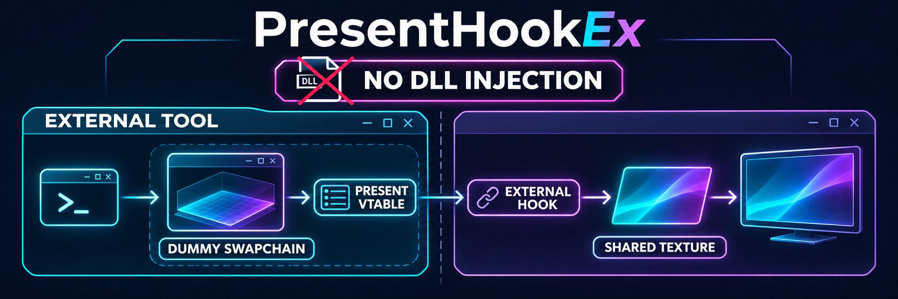

# PresentHookEx [Preview On Youtube](https://www.youtube.com/watch?v=y_eP96DWTU4)
An external Direct3D 11 Present-hook example built with [LiquidHookEx](https://github.com/xsip/LiquidHookEx/blob/main/README.md). The example creates a headless ImGui renderer in the injector process, shares its rendered texture with the target process, and composites that texture from an `IDXGISwapChain::Present` hook.

The hook supports two ways to select its Present target: pass an `IDXGISwapChain*` to `LiquidHookEx::Present::Hook(pSwapChain)`, or call `LiquidHookEx::Present::Hook()` to automatically create and use a temporary dummy DX11 swapchain in the selected target process. The example does not look up a game overlay DLL or depend on a particular game's modules.

## Overview

The sample demonstrates:

- External x64 process attachment and hook installation through LiquidHookEx.
- Remote creation of a dummy window, DX11 device, and swapchain to obtain a valid target-process swapchain object.
- A headless Dear ImGui renderer running outside the target process.
- Cross-process texture sharing synchronized with `IDXGIKeyedMutex`.
- Compositing the shared overlay texture onto a DX11 back buffer in the Present hook.
- Saving and restoring the D3D11 pipeline state touched by the composite draw.

When using the automatic path, the dummy swapchain provides a target-process DX11 Present vtable entry for the external hook. It is not a discovery mechanism for a game's active rendering swapchain. If you already have the relevant swapchain, pass it directly to `Hook(pSwapChain)`. Applications may use different swapchain vtables or present through another path, so choose a swapchain whose Present function is called by the target rendering flow.

## Architecture

| Project | Role |
|---|---|
| `Example` | Configures the target process, obtains a dummy swapchain, starts the renderer, installs the hook, and coordinates shutdown. |
| `HeadlessRenderer` | Creates a standalone D3D11 device and shared texture, renders ImGui, and publishes the shared texture handshake. |
| `LiquidHookEx` | Provides the external process and VTable hook machinery used by the example. |

### Frame path

```text
Example process                         Target process
---------------                         --------------
HeadlessRenderer -> shared texture ---> Present hook -> target back buffer
                    keyed mutex             ^
                                             |
                          dummy swapchain's Present vtable slot
```

The renderer publishes the shared texture handle, dimensions, and producer PID through a named file mapping (`Local\\LiquidOverlayHandshake`). The first Present-hook invocation opens that texture in the target process and creates the resources used to composite it. The producer and consumer coordinate access using keyed mutex keys 0 and 1.

## Startup and shutdown

`Example/Main.cpp` shows the complete sequence:

1. Set `szExe` to the target executable name and initialize LiquidHookEx with `LiquidHookEx::INIT`.
2. Initialize the ImGui context and start `HeadlessRenderer`; wait for its shared texture to become ready.
3. Install the hook using either `LiquidHookEx::Present::Hook()` for automatic dummy swapchain acquisition, or `LiquidHookEx::Present::Hook(pSwapChain)` when you have a swapchain to use.
4. Run application logic until the Insert key is pressed (as in the current sample).
5. Unhook Present and stop the renderer.

The automatic `Hook()` overload obtains the dummy swapchain and releases its temporary DX11 resources as part of the helper flow in `LiquidPresentEx.cpp`. The `Hook(pSwapChain)` overload uses the pointer supplied by the caller. Ensure the swapchain is valid in the target process and keep its lifetime appropriate for your hook lifecycle.

## Build and run

1. Open `PresentHookEx.slnx` in Visual Studio with the C++ desktop development workload and a Windows SDK installed.
2. Build the `Example` and `HeadlessRenderer` projects for **x64**. The repository includes the LiquidHookEx sources and Dear ImGui sources used by these projects.
3. In `Example/Main.cpp`, set `szExe` to the target executable name.
4. Start the target application, then run the built Example with the required permissions to open and modify that process.
5. Press **Insert** to request shutdown in the current sample.

The target must be a compatible 64-bit Windows process using Direct3D 11. The example is process-agnostic in its setup; it does not make every graphics API or every swapchain arrangement compatible automatically.

## Project layout

```text
PresentHookEx/
├── Example/
│   ├── Main.cpp                         # Example startup and shutdown
│   ├── Include/Example/
│   │   └── LiquidPresentEx.h             # Present hook data and interface
│   └── Source/Example/
│       ├── SwapChainObtainer.cpp         # Remote dummy DX11 resource helper implementation
│       └── LiquidPresentEx.cpp           # Present hook, overloads, and dummy acquisition flow
├── HeadlessRenderer/
│   ├── Include/HeadlessRenderer/         # Renderer and render-object interfaces
│   └── Source/HeadlessRenderer/          # D3D11, shared texture, input, and render loop
├── LiquidHookEx/                         # External hooking library and examples
└── PresentHookEx.slnx
```

## Notes

- The sample's `bHandleResize` path is disabled in the Present hook because its current resource teardown has a keyed-mutex protocol issue. Resize behavior should be reviewed before enabling it.
- The demo's main loop only waits for the Insert key. Add your own render objects or application logic to the example as needed.
- Consult [LiquidHookEx's README](https://github.com/xsip/LiquidHookEx/blob/main/README.md) for details about its hook mechanisms and configuration.
